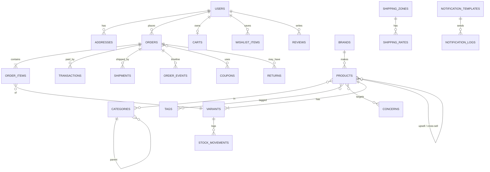

# 04 · Architecture

Version 1.0 · Sprint 0. This document is updated whenever the data model or integrations change.

## 1. Stack
| Layer | Technology | Version | Notes |
|---|---|---|---|
| Framework | Next.js (App Router, Turbopack, React Server Components) | 16.4 | Storefront and admin in one app |
| CMS / backend | Payload CMS | 3.93 | Admin UI, REST/GraphQL/Local API, auth, access control, hooks, jobs |
| Database | PostgreSQL (via `@payloadcms/db-postgres` / Drizzle) | 16 | Local: Docker on port **5434** |
| Styling | Tailwind CSS v4 (CSS-first `@theme` tokens) | 4.3 | Scoped to the `(frontend)` route group |
| Motion | GSAP + ScrollTrigger (`@gsap/react`), Motion (Framer Motion), Lenis | 3.15 / 14 / 1.3 | GSAP for timelines and scroll, Motion for UI state, Lenis for smooth wheel scrolling (on GSAP's ticker) |
| Icons | Tabler Icons (`@tabler/icons-react`) | 3.51 | Lucide is not used, per your requirement |
| UI utils | class-variance-authority, clsx, tailwind-merge, Embla Carousel, Sonner (toasts) | | |
| Images | `next/image` (AVIF/WebP) + `sharp` (Payload image sizes) | | |
| Testing | Vitest (integration), Playwright (E2E and visual QA) | | |
| Language | TypeScript (strict) | 5.7 | |

## 2. System context
```mermaid
flowchart LR
  shopper([Shopper<br/>mobile / desktop]) -->|HTTPS| next
  staff([Staff]) -->|/admin| next
  subgraph app[Next.js 16 app]
    next[Storefront routes<br/>src/app/(frontend)]
    admin[Payload Admin + API<br/>src/app/(payload)]
    next -- Local API --> payload[(Payload core<br/>collections · hooks · access · jobs)]
    admin --> payload
  end
  payload --> pg[(PostgreSQL 16)]
  payload --> media[(Object storage<br/>S3-compatible, Sprint 10)]
  payload -->|redirect + notify| payhere[PayHere IPG]
  payload -->|redirect + callback| koko[Koko BNPL]
  payload -->|redirect + callback| mintpay[Mintpay BNPL]
  payload -->|SMTP / API| email[Email: SMTP / Resend]
  payload -->|HTTP API| sms[SMS: Notify.lk / Text.lk]
  payload -->|Cloud API| wa[WhatsApp Business]
  payload -->|API / manual| courier[Couriers: Domex, Koombiyo, Pronto…]
  next -->|consent-gated| ga[GA4 / Meta Pixel]
```

## 3. Code layout
```
theonlinestore/
├─ docs/                       Project documents (this folder)
├─ public/brand/               Logo, icon, OG image
├─ public/catalogue/           Product photos extracted from the client PDFs
├─ seed/catalogue/products.json  Structured seed catalogue (88 products / 99 variants)
├─ scripts/                    check-contrast.ts, screenshots.mjs, seed-admin.ts
├─ src/
│  ├─ app/(frontend)/          Storefront: layout, globals.css (tokens), fonts, pages
│  ├─ app/(payload)/           Payload admin + API routes (generated), custom.scss (admin theme)
│  ├─ access/roles.ts          RBAC roles and access helpers
│  ├─ collections/             Products, Categories, Brands, Tags, Concerns, StockMovements, Media, Users
│  ├─ globals/                 HomePage (hero products + product rails)
│  ├─ components/ui/           Design-system primitives
│  ├─ components/layout/       Header, search, mega-menu, bag drawer, footer, bottom nav
│  ├─ components/home/         Home page sections
│  ├─ components/product/      ProductCard, ProductRail, QuickAddSheet
│  ├─ components/brand/        Logo, BrandLoader
│  ├─ config/                  site.ts (store settings), navigation.ts (IA)
│  ├─ lib/catalog/             types.ts + utils.ts (browser-safe), server.ts (Payload Local API, server-only), params.ts
│  ├─ lib/payload/             revalidate.ts (refresh cached pages after admin edits)
│  ├─ lib/store/shop.tsx       Bag, wishlist and UI state (client)
│  ├─ lib/motion/              Motion tokens, GSAP setup, Reveal helper
│  └─ payload.config.ts
└─ tests/                      int (Vitest) and e2e (Playwright)
```

## 4. Rendering and state strategy
- **Server Components by default.** Interactive pieces (header, bag, cards, carousels) are client components.
- The home page and content pages are **static** (ISR from Sprint 1, revalidated by Payload `afterChange` hooks). Product listing and product pages use ISR. Account, checkout and the bag are dynamic.
- **Prices and totals are always calculated on the server** (Sprint 4). The client bag is optimistic UI only.
- Bag and wishlist: `localStorage` for guests now. From Sprint 4 they are server-side `carts` and `wishlists`, merged at sign-in.
- Relative timers (deal countdowns) are resolved in the browser so static pages never show stale times.

## 5. Data model

### Built in Sprint 1
| Collection / global | Purpose | Key fields |
|---|---|---|
| `products` | Sellable products (drafts, versions, scheduled publish) | **productType** (beauty, fragrance, footwear, gift, chocolate, accessory, home), **isDemo**, name, slug, brand, categories, short description, rich description, benefits, how to use, ingredients, optionName, option2Name, **variants[]** (label, option2, sku, barcode, price, compareAtPrice, cost, weight, stock, lowStockThreshold, image), gallery, badge, tags, concerns, recipients, occasions, **details** (type-specific group: fragrance notes and concentration; footwear style, material, size system, fit; chocolate weight, cocoa %, origin, dietary, allergens, storage; gift contents, wrapping, personalisation; gender), crossSells, upsells, priceTBC, SEO meta; **computed:** minPrice, maxPrice, totalStock, lowStock, onSale, searchText, salesCount, rating*, reviewCount* |
| `categories` | Category tree (nested-docs plugin) | name, slug, parent, breadcrumbs (`/skincare/serums`), blurb, description, tint, image, order, SEO meta |
| `brands` | Brands | name, slug, group (K-Beauty, Derm…), featured, logo, description, SEO meta |
| `tags`, `concerns` | Merchandising tags and shopper concerns (concerns apply to beauty) | name, slug |
| `recipients`, `occasions` | Gift taxonomy (Sprint 1.5) | name, slug |
| `stock-movements` | Inventory audit log, written automatically and never edited | product, sku, variantLabel, change, resultingStock, reason, note, user |
| `home-page` (global) | Home merchandising | heroProducts (≤ 4), rails[] (source: manual, sale, bestsellers, new, tag, category, under price; placement; style; countdown) |

\* rating and reviewCount are calculated from approved reviews (Sprint 2).

**How data reaches pages:**
- Server Components call `src/lib/catalog/server.ts` (Payload Local API, wrapped in React `cache()`), which maps documents into plain `Product` / `ProductDetail` objects.
- Client Components only ever receive those objects as props.
- The bag stores a snapshot per line (name, photo, price), so the browser never loads the catalogue. Prices are re-checked on the server at checkout (Sprint 4).

**Caching:**
- Product pages are pre-rendered for every published product and revalidate hourly. The home page, brands and category directory revalidate every 10 minutes.
- **Admin edits revalidate immediately** through `afterChange` hooks (`lib/payload/revalidate.ts`). Seed scripts pass `context.disableRevalidate`.
- Measured on a production build: home 4 ms, product page 2 ms, filtered listings about 20 ms.

**Endpoints:**
- `GET /api/products/suggest?q=` returns header autosuggest results (published products and brands, cached 60 s at the edge).
- `POST /api/products/adjust-stock` (Sprint 1.5) takes `{ productId, changes: [{ sku, stock }], reason, note }`. It is limited to admin, store-manager and inventory-manager, writes with `overrideAccess: false`, and passes the reason and note to the stock-movement hook. It returns `{ ok, totalStock, lowStock }`.

### Custom admin (Sprint 1.5)
The Payload admin is customised through its component API, without forking Payload. All of it is in `src/components/admin/` and is styled by `src/app/(payload)/custom.scss` (the admin doesn't load Tailwind).

| Slot | Component | What it does |
|---|---|---|
| `admin.components.Nav` | `Nav.tsx` (server) + `NavClient.tsx` | Grouped sidebar (Home, Sales, Catalogue, Content, Insights, Settings), role-aware, with live badges for drafts and low stock |
| `admin.components.actions` | `HeaderActions.tsx` | Search (⌘K) and View store |
| `admin.components.providers` | `CommandPalette.tsx` | ⌘K palette: product search by name or SKU, pages, actions |
| `admin.components.beforeLogin` | `LoginIntro.tsx` | Branded login |
| `views.dashboard` | `views/Dashboard.tsx` | KPIs, needs attention, activity, launch checklist, catalogue mix |
| `views.inventory` (`/admin/inventory`) | `views/Inventory.tsx` + `InventoryTable.tsx` | Bulk stock adjustment. Wraps Payload's `DefaultTemplate`. |
| `products` list view | `views/ProductsList.tsx` + `ProductsToolbar` + `ProductsTable` | Status tabs, search, type filter, sort, bulk actions through the REST API |
| Variant `RowLabel` | `VariantRowLabel.tsx` | Readable collapsed variant rows |

**Demo data:** products with `isDemo` come from `pnpm seed:demo` (SKUs `DEMO-…`, media `demo-*.webp`, four fictional brands). Their pages are `noindex`. `pnpm seed:demo --remove` deletes the products, their stock history, their media and the demo brands.

### Added in Sprint 2 (discovery)
| Collection | Purpose | Key fields |
|---|---|---|
| `reviews` | Shopper reviews, moderated | product, rating 1–5, title, body, photos (≤3), reply, authorName, authorEmail (staff-only read), status (pending/approved/rejected), verifiedBuyer, helpfulCount, isSample, moderationNote (staff-only), user |
| `review-media` | Review photo uploads (kept apart from the product Media library) | file (WebP, thumb + large sizes), `public` (true only while its review is approved) |
| `search-queries` | Search analytics, one row per normalised term per day | term, day (YYYY-MM-DD, Asia/Colombo), count, results; unique (term, day) |

**Search (`src/lib/catalog/search.ts`):**
- PostgreSQL `pg_trgm` + `fuzzystrmatch`, declared in the Postgres adapter (`extensions` and an `afterSchemaInit` GIN index on `products.search_text`), so schema sync and migrations create them.
- A query matches when every word is in the product's search text, either as a substring or by trigram word-similarity, or when the whole query matches with spaces removed.
- Ranking: name matches, then similarity, then popularity.
- Zero results: an edit-distance correction against the store's own vocabulary ("cervae" → "cerave"), which is applied automatically.
- Each search is upserted into `search_queries` after the response (`after()`).

**Facets (`src/lib/catalog/facets.ts`):**
- An in-memory snapshot of the published catalogue (one light record per product), rebuilt when the catalogue changes (`bumpCatalogVersion()` in the revalidate hooks) or after 60 s.
- Filtering, disjunctive counts and sorting run in one pass. Only the current page is loaded in full.
- Every listing uses `getListing(scope, params)`; search uses `getSearchListing`.
- Filters live in the URL (`?brand=a,b&min=&max=&rating=&stock=1&sale=1&size=&colour=&scent=&diet=&cat=&type=&concern=&recipient=&occasion=`).

**Reviews:**
- The approved-review average and count are written straight to the product row inside the review's transaction, with no new product version, and the product page is revalidated.
- The public reads approved reviews only. Field access hides the email, user and moderation note.

**New endpoints:**
| Endpoint | Who | Purpose |
|---|---|---|
| `GET /api/products/suggest?q=` | Public | Typo-tolerant suggestions: products, brands, categories, correction, total (cached 60 s) |
| `GET /api/products/facets?scope=&…filters` | Public | Live count + facets for the phone filter sheet (`scope` is an encoded listing scope, validated on the server; only published products are ever returned) |
| `GET /api/products/cards?slugs=` | Public | Product cards for wishlist and recently viewed |
| `GET /api/products/pairs?slug=` | Public | Cross-sells for the bag drawer |
| `GET /api/products/export` | Admin, store/inventory manager, marketing | CSV of every SKU (cost only for price roles) |
| `POST /api/products/import` `{ csv, apply }` | Price roles / stock roles | Preview or apply price and stock updates by SKU |
| `POST /api/reviews/submit` (multipart) | Public, rate-limited, honeypot | New review (pending) with up to 3 photos |
| `GET /api/reviews/list?product=&sort=&rating=&photos=` | Public | Approved reviews, paginated |
| `POST /api/reviews/:id/helpful` | Public, once per visitor | +1 helpful |
| `POST /api/reviews/moderate` `{ ids, status }` | Moderators | Approve or reject in bulk |

**New admin views:**
- Reviews moderation (list view override).
- `/admin/import-export`.
- `/admin/search-insights`.
- `AdminPage` wraps custom routes in Payload's template.

### Added in Sprint 3 (accounts & security)
**Users (auth collection):**
- Auth settings:
  - `verify` (email confirmation) and `forgotPassword` (1 h, single use), both with branded templates in `lib/email/templates.ts`.
  - Lockout after 5 attempts (15 min). Lax cookies, secure in production.
- New fields: `addresses[]` (label, recipient, phone, line1/2, city, district (25), postalCode, landmark, isDefault), `marketingChannels`, `marketingConsentAt`, `deletionRequestedAt`, `wishlist` (json), `staffNote` (staff only).
- Access is scoped per role (see the RBAC matrix). `POST /api/users/wishlist` merges or replaces the account wishlist.

**Storefront auth:**
- Server actions (`app/(frontend)/account/actions.ts`) call Payload's Local API (`login`, `forgotPassword`, `resetPassword`, `verifyEmail`). They set the http-only `payload-token` cookie themselves: 30 days with "Keep me signed in", otherwise a browser-session cookie.
- `lib/auth/server.ts` (`getCurrentUser`, `requireUser`, `safeNext`) protects pages.
- `AuthProvider` (client, `/api/users/me`) drives the header and the wishlist sync. Sign-out uses `POST /api/users/logout`, which also ends the server session.

**Email:** `@payloadcms/email-nodemailer` over SMTP (`SMTP_*` and `EMAIL_FROM_*` env vars). Locally it sends to Mailpit (docker-compose, SMTP :1026, inbox :8026). Without `SMTP_HOST`, emails are printed to the console.

**Audit log:**
- `audit-logs` collection, written by `lib/payload/audit.ts` inside the request's transaction.
- Hooks: users (roles, staff created, deletion requests, deletes), products (price, compare-at and cost diffs per SKU; deletes), reviews (moderation, deletes), categories, brands and taxonomies (deletes), the home-page global (edits), CSV import (apply).

**Rate limiting:** `lib/server/rateLimit.ts`, in memory, keyed by `clientIp()` (`X-Real-IP`, then the last `X-Forwarded-For` entry).

### Added in Sprint 4 (checkout)
**Collections and globals:**
- `orders`: `orderNumber` (`TOS-YYMMDD-XXXX`), `items[]` (product, sku, name, brand, variant, image, unit price, line subtotal, discount, line total: a snapshot, so later price changes never alter an order), `discounts[]`, `totals` (subtotal, discountTotal, delivery incl. any COD fee, giftWrap, total), `contact`, `shippingAddress`, `delivery` (method, zone, eta), `gift`, `customerNote`, `status` (12 values), `paymentMethod`, `paymentStatus`, `customer`, `coupon`, `termsAcceptedAt` + `termsVersion`, `timeline[]`, `staffNotes`, `stockReturned`, `accessToken` (hidden), `clientIp`. Create access is `false` for everyone: only the place endpoint creates orders. Hooks add a timeline entry on each status change and restock once when an order is cancelled.
- `discounts`: mode (automatic | code), type (percent | fixed | free-shipping | bogo), value, buy/get rules, scope (all, products, categories incl. children, brands), minSpend, maxDiscount, excludeSaleItems, combinable, priority, dates, usage limits (total, per customer), firstOrderOnly, usedCount. A virtual `offer` field gives the list a plain-language summary.
- `checkout-settings` global: free-delivery threshold, included weight and per-kg fee, zones (districts → fee + ETA), fallback fee, same-day (fee, cut-off hour, districts), COD (maximum, fee), bank transfer (instructions, hold hours), gift wrap fee, terms version.
- `users.cart` (json): the signed-in bag. `POST /api/users/cart` merges (keeping the larger quantity) or replaces it, re-priced through `loadLines`.

**Pricing:** `lib/checkout/pricing.ts` is a pure function, `quote()`, with no database access, so it is fully unit-tested (27 scenarios). Order: line subtotals → automatic promotions by priority → one coupon (the better of coupon vs promotions when not combinable) → delivery (zone fee + weight surcharge; free above the threshold *after* discounts or with a free-delivery code; same-day is a flat fee and never free) → gift wrap. Discounts are allocated to lines and rounded to the rupee per line.

**Server side:** `lib/checkout/server.ts` loads settings, lines (clamped to stock, 300 g default weight), automatic promotions and the coupon (dates, limits, uses per email, phone or account, first order), then calls `quote()`.

**Placing an order** (`POST /api/orders/place`, `endpoints/checkout.ts`):
1. Validate the form (Sri Lankan mobile, email, address, district, payment, terms) and return field messages.
2. Re-quote. Refuse (409) if the bag changed, the coupon is invalid, the payment method isn't available, same-day has closed, or the total differs from `expectedTotal` (the total the shopper saw).
3. In one transaction: `SELECT … FOR UPDATE` on the products, re-quote inside the lock, decrement stock (logged as a `sale` stock movement), add to `salesCount`, create the order, count the coupon use, clear the account bag. Any failure rolls everything back.
4. After commit: send the confirmation email (never blocks the order) and return the confirmation link with the private token.

The integration test races two shoppers for the last units: exactly one order succeeds and stock never goes below zero.

**Stock history:** `stock-movements.product` is now optional, so deleting a product keeps its history (SKU and variant name stay on each row).

### Added in Sprint 5 (payments)
**Collections and globals:** `payment-settings` (mode Test/Live, hold time for online orders, test gateway switch; per method: on/off, position, min/max order, label; PayHere, Koko and Mintpay credentials; COD fee and excluded districts; bank instructions and hold hours). `transactions` (reference = the gateway's order id `TOS-…-P1`, order, method, status, amount, gateway payment id, signature result, test flag, slip, staff member, events[]). `payment-slips` (private uploads in `private/payment-slips`, status pending/verified/rejected). Orders gain `paymentDueAt` and `paidAt`; payment status adds processing, slip to verify and failed.

**Flow for card and instalments:**
1. Place order creates the order as *pending payment* with a pay-by time (60 min) and reserves stock, then sends the browser to `/checkout/pay/[orderNumber]?t=…`.
2. The pay page starts an attempt (`startAttempt`, one `transactions` row per attempt) and either posts PayHere's signed form (`hash = UPPER(MD5(merchant_id + order_id + amount + currency + UPPER(MD5(secret))))`) or, without credentials in Test mode, opens the built-in test gateway.
3. PayHere calls `POST /api/transactions/notify/payhere`. `parsePayhereNotify` checks the merchant and `md5sig`; `applyGatewayResult` locks the attempt row, ignores repeats, refuses a wrong amount (order put on hold), and marks the order paid → processing. The confirmation email goes after payment.
4. The shopper returns to the order page, which polls `GET /api/orders/payment-status` until the gateway has answered.

**Test gateway:** `/checkout/pay/test-gateway` signs its result exactly like the gateway (PayHere's md5sig, or HMAC-SHA256 for Koko/Mintpay) with a secret derived from `PAYLOAD_SECRET`, and goes through the same `applyGatewayResult`. It runs only in Test mode and only outside production, unless `ALLOW_TEST_GATEWAY=true` (local `.env` only, so production builds can be tested).

**Koko and Mintpay:** both APIs are shared only with signed-up merchants, so their live adapters are not written yet. `gatewayRoute()` returns the test gateway for them in Test mode and hides them otherwise. Adding a live adapter means one `start` (build the request) and one notify endpoint (verify the signature, then call `applyGatewayResult`).

**Bank transfer:** slip upload (`POST /api/orders/slip`) → order *slip to verify* → staff Verify / Reject in the order's Payment panel (`POST /api/orders/:id/payment`) → paid + processing, or back to unpaid with the reason emailed.

**Releasing unpaid orders:** a Payload job (`releaseUnpaidOrders`, every 5 minutes via `jobs.autoRun`) cancels pending-payment orders past their pay-by time that are unpaid or failed (not those with a slip waiting or a gateway still processing); the order hook returns the stock.

**Secrets:** `PAYHERE_MERCHANT_ID/SECRET`, `KOKO_*`, `MINTPAY_*` env vars override stored values. Gateway notify URLs must be public HTTPS, so a live sandbox run needs a deployed staging site or a tunnel.

### Added in Sprint 6 (orders & delivery)
**Collections:** `couriers` (name, tracking link with `{tracking}`, needs tracking, collects COD). `returns` (RET-number, order, items with refund per unit, reason, status requested → approved → received → refunded / rejected / closed, timeline). Orders gain `shipment` (courier, tracking number, note), `statusDates` (packedAt … returnedAt), `refundedTotal`, `codRemittance`; payment status adds *partly refunded*; transactions add *refunded* / *refund failed*.

**Lifecycle:** `lib/orders/lifecycle.ts` holds the allowed steps (`NEXT`), `checkTransition()` and the shopper progress. The orders `beforeChange` hook enforces it for staff and stamps `statusDates`; the `afterChange` hook restocks on cancellation (or a failed delivery returned to us) and sends the "on its way" email on shipping.

**Endpoints:** `POST /api/orders/bulk-status`, `POST /api/orders/cod-remittance`, `POST /api/orders/:id/payment` (+ `refund`), `POST /api/returns/request`, `POST /api/returns/:id/action`. Refunds live in `lib/payments/refunds.ts` (PayHere Refund API: OAuth token with App ID/secret, then `/payment/refund` with `payment_id`, `description` and an optional partial `amount`).

**Pages:** `/print/orders` (own root layout `app/(print)`, A4 print CSS, many orders at once), `/track-order` (server action → `/orders/[orderNumber]?t=…`), `/orders/[orderNumber]` (progress, courier link, payment, invoice, Buy again, returns). Admin: Orders list filters and bulk bar (`OrdersTable`), Payment panel refunds, Return panel, `/admin/cod` (COD reconciliation).

**Testing note:** e2e test orders reserve real stock, so `tests/helpers/cleanupOrders.ts` runs as Playwright's global teardown and cancels them (stock back) before deleting them. Rate limits are per server process; run the suite against a freshly started server.

### Added in launch preparation (v0.9.0)
**Admin-managed settings:** `store-settings` (name, description, contact, social, announcements, delivery estimate), `policies` (terms/returns/privacy rich text, terms version, return window, non-returnable product types), free delivery on/off in `checkout-settings`, bank accounts and instalment display/fee in `payment-settings`, banners & messages in `home-page`. `lib/store/settings.ts` (`getStoreSettings`) turns them into one public object per request; `StoreSettingsProvider` passes it to client components. Saving any of these globals revalidates the whole storefront (`lib/store/refresh.ts`). `config/site.ts` now only holds fixed identity (URL, domain, currency).

**Empty-store behaviour:** menus, tiles, search suggestions, the 404 page and the footer only link to categories that exist; home sections with no products or switched off disappear.

**Production:** `output: 'standalone'`; `pnpm build` copies public and static assets next to `server.js`. Upload folders resolve from `UPLOADS_DIR` (outside the build). Migrations live in `src/migrations` and run via `pnpm payload migrate` in `deploy/deploy.sh` (never at start-up). Caddy terminates HTTPS and sets `X-Real-IP`; Postgres runs in Docker on 127.0.0.1 only; the app runs under systemd. Security headers come from `next.config.ts`; `robots.ts` and `sitemap.ts` at the app root.

**Test gateway isolation:** all of it lives in `lib/payments/simulator.ts` and `app/(frontend)/checkout/pay/test-gateway/`; the production branch deletes the folder and stubs the module.

### Target (Sprints 2–7)


**Collections:**
- Users
- Media
- Products (variants as an array field with stable IDs)
- Categories (nested)
- Brands
- Tags
- Concerns
- StockMovements
- Carts
- Orders
- Transactions
- Shipments
- Returns
- Coupons
- ShippingZones
- Reviews
- Pages
- Posts
- Redirects
- NotificationTemplates
- NotificationLogs
- AuditLogs

**Globals:**
- StoreSettings: contact details, free-delivery threshold, announcements.
- PaymentSettings: methods, credentials, rules.
- NotificationSettings.
- HomePage: blocks.
- Header/Footer navigation.

**Money:** stored as integer rupees (LKR has no common sub-unit use in retail). Fields: `price`, `compareAtPrice` and `cost` per variant.

## 6. Integrations
| Integration | Sprint | Approach |
|---|---|---|
| PayHere | 5 | Hosted checkout form POST. `notify_url` endpoint verifies `md5sig = MD5(merchant_id + order_id + amount + currency + status_code + MD5(secret).upper)`. Idempotent order update. Refund API. |
| Koko | 5 | Create-order API → redirect. Callback with signature verification. Status poll for reconciliation. |
| Mintpay | 5 | Create-order API → redirect. Success/fail callbacks. Status check API. |
| Bank transfer | 5 | Bank details from PaymentSettings. Slip upload to a private media collection. Staff verify. Auto-cancel job. |
| COD | 5 | Eligibility rules (max value, districts). Optional OTP (TOS-1202). |
| Email | 7 | Payload email adapter (Nodemailer SMTP or Resend). React Email templates. |
| SMS | 7 | Notify.lk / Text.lk HTTP API behind a provider interface. |
| WhatsApp | 7 | Meta WhatsApp Cloud API with pre-approved templates. |
| Couriers | 6 | Manual tracking number + URL template first. Koombiyo/Domex APIs where available. |
| Analytics | 8 | GA4 + Meta Pixel, loaded after cookie consent. Server-side purchase event. |
| Search | 2 | Postgres full-text (`tsvector`) + trigram similarity for typo tolerance. Meilisearch optional later. |

## 7. Security
- Payload auth: HTTP-only cookies, 5 failed logins → 15-minute lockout, 7-day sessions.
- RBAC via `src/access/roles.ts`: collection, row and field level, with roles saved to the JWT.
- The first user ever created becomes the super-admin (bootstrap). **In production, create the admin immediately after the first deploy.**
- Secrets live only in environment variables. `.env` is git-ignored; `.env.example` documents the keys.
- Payment callbacks: signature verification, idempotency keys, amount and currency checks against the order.
- Rate limits (Sprint 3/10) on auth, search, checkout and coupons.

## 8. Environments
| Env | URL | DB | Notes |
|---|---|---|---|
| Local | http://localhost:3000 | Docker Postgres :5434 | `docker compose up -d` → `pnpm dev` |
| Staging | staging.theonlinestore.lk (Sprint 10) | Managed Postgres | Payment sandboxes |
| Production | https://theonlinestore.lk | Managed Postgres + daily backups | Live keys |

## 9. Local development
```bash
docker compose up -d            # Postgres 16 on :5434
pnpm install
cp .env.example .env            # then set PAYLOAD_SECRET and the SEED_ADMIN_* values
pnpm dev                        # http://localhost:3000 and /admin
pnpm seed:admin                 # optional: create the local super-admin from .env
pnpm lint && pnpm typecheck && pnpm check:contrast
pnpm test:e2e                   # Playwright (reuses the dev server)
```
