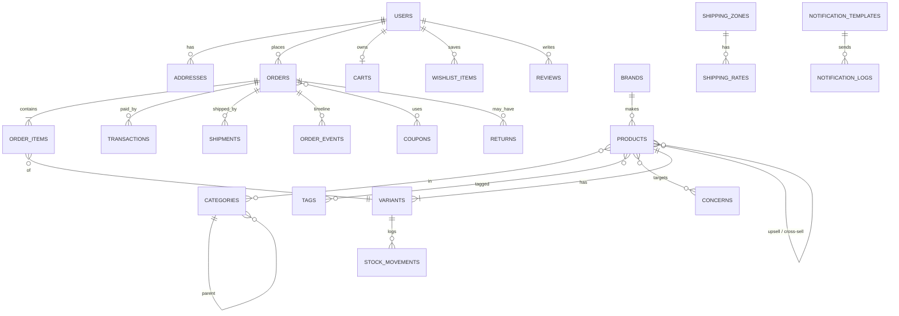

# 04 · Architecture

Version 1.0 · Sprint 0. This document is updated whenever the data model or integrations change.

## 1. Stack
| Layer | Technology | Version | Notes |
|---|---|---|---|
| Framework | Next.js (App Router, Turbopack, React Server Components) | 16.4 | Storefront and admin in one app |
| CMS / backend | Payload CMS | 3.93 | Admin UI, REST/GraphQL/Local API, auth, access control, hooks, jobs |
| Database | PostgreSQL (via `@payloadcms/db-postgres` / Drizzle) | 16 | Local: Docker on port **5434** |
| Styling | Tailwind CSS v4 (CSS-first `@theme` tokens) | 4.3 | Scoped to the `(frontend)` route group |
| Motion | GSAP + ScrollTrigger (`@gsap/react`), Motion (Framer Motion) | 3.15 / 14 | GSAP for timelines and scroll, Motion for UI state |
| Icons | Tabler Icons (`@tabler/icons-react`) | 3.51 | Lucide is not used, per your requirement |
| UI utils | class-variance-authority, clsx, tailwind-merge, Embla Carousel, Sonner (toasts) | | |
| Images | `next/image` (AVIF/WebP) + `sharp` (Payload image sizes) | | |
| Testing | Vitest (integration), Playwright (E2E and visual QA) | | |
| Language | TypeScript (strict) | 5.7 | |

## 2. System context
```mermaid
flowchart LR
  shopper([Shopper<br/>mobile / desktop]) -->|HTTPS| next
  staff([Staff]) -->|/admin| next
  subgraph app[Next.js 16 app]
    next[Storefront routes<br/>src/app/(frontend)]
    admin[Payload Admin + API<br/>src/app/(payload)]
    next -- Local API --> payload[(Payload core<br/>collections · hooks · access · jobs)]
    admin --> payload
  end
  payload --> pg[(PostgreSQL 16)]
  payload --> media[(Object storage<br/>S3-compatible, Sprint 10)]
  payload -->|redirect + notify| payhere[PayHere IPG]
  payload -->|redirect + callback| koko[Koko BNPL]
  payload -->|redirect + callback| mintpay[Mintpay BNPL]
  payload -->|SMTP / API| email[Email: SMTP / Resend]
  payload -->|HTTP API| sms[SMS: Notify.lk / Text.lk]
  payload -->|Cloud API| wa[WhatsApp Business]
  payload -->|API / manual| courier[Couriers: Domex, Koombiyo, Pronto…]
  next -->|consent-gated| ga[GA4 / Meta Pixel]
```

## 3. Code layout
```
theonlinestore/
├─ docs/                       Project documents (this folder)
├─ public/brand/               Logo, icon, OG image
├─ public/catalogue/           Product photos extracted from the client PDFs
├─ seed/catalogue/products.json  Structured seed catalogue (88 products / 99 variants)
├─ scripts/                    check-contrast.ts, screenshots.mjs, seed-admin.ts
├─ src/
│  ├─ app/(frontend)/          Storefront: layout, globals.css (tokens), fonts, pages
│  ├─ app/(payload)/           Payload admin + API routes (generated), custom.scss (admin theme)
│  ├─ access/roles.ts          RBAC roles and access helpers
│  ├─ collections/             Payload collections (Users, Media; more from Sprint 1)
│  ├─ components/ui/           Design-system primitives
│  ├─ components/layout/       Header, search, mega-menu, bag drawer, footer, bottom nav
│  ├─ components/home/         Home page sections
│  ├─ components/product/      ProductCard, ProductRail, QuickAddSheet
│  ├─ components/brand/        Logo, BrandLoader
│  ├─ config/                  site.ts (store settings), navigation.ts (IA)
│  ├─ lib/catalog.ts           Catalogue data access (seed now, Payload from Sprint 1)
│  ├─ lib/store/shop.tsx       Bag, wishlist and UI state (client)
│  ├─ lib/motion/              Motion tokens, GSAP setup, Reveal helper
│  └─ payload.config.ts
└─ tests/                      int (Vitest) and e2e (Playwright)
```

## 4. Rendering and state strategy
- **Server Components by default.** Interactive pieces (header, bag, cards, carousels) are client components.
- The home page and content pages are **static** (ISR from Sprint 1, revalidated by Payload `afterChange` hooks). Product listing and product pages use ISR. Account, checkout and the bag are dynamic.
- **Prices and totals are always calculated on the server** (Sprint 4). The client bag is optimistic UI only.
- Bag and wishlist: `localStorage` for guests now. From Sprint 4 they are server-side `carts` and `wishlists`, merged at sign-in.
- Relative timers (deal countdowns) are resolved in the browser so static pages never show stale times.

## 5. Data model (target, built across Sprints 1–7)


**Collections:**
- Users
- Media
- Products (variants as an array field with stable IDs)
- Categories (nested)
- Brands
- Tags
- Concerns
- StockMovements
- Carts
- Orders
- Transactions
- Shipments
- Returns
- Coupons
- ShippingZones
- Reviews
- Pages
- Posts
- Redirects
- NotificationTemplates
- NotificationLogs
- AuditLogs

**Globals:**
- StoreSettings: contact details, free-delivery threshold, announcements.
- PaymentSettings: methods, credentials, rules.
- NotificationSettings.
- HomePage: blocks.
- Header/Footer navigation.

**Money:** stored as integer rupees (LKR has no common sub-unit use in retail). Fields: `price`, `compareAtPrice` and `cost` per variant.

## 6. Integrations
| Integration | Sprint | Approach |
|---|---|---|
| PayHere | 5 | Hosted checkout form POST. `notify_url` endpoint verifies `md5sig = MD5(merchant_id + order_id + amount + currency + status_code + MD5(secret).upper)`. Idempotent order update. Refund API. |
| Koko | 5 | Create-order API → redirect. Callback with signature verification. Status poll for reconciliation. |
| Mintpay | 5 | Create-order API → redirect. Success/fail callbacks. Status check API. |
| Bank transfer | 5 | Bank details from PaymentSettings. Slip upload to a private media collection. Staff verify. Auto-cancel job. |
| COD | 5 | Eligibility rules (max value, districts). Optional OTP (TOS-1202). |
| Email | 7 | Payload email adapter (Nodemailer SMTP or Resend). React Email templates. |
| SMS | 7 | Notify.lk / Text.lk HTTP API behind a provider interface. |
| WhatsApp | 7 | Meta WhatsApp Cloud API with pre-approved templates. |
| Couriers | 6 | Manual tracking number + URL template first. Koombiyo/Domex APIs where available. |
| Analytics | 8 | GA4 + Meta Pixel, loaded after cookie consent. Server-side purchase event. |
| Search | 2 | Postgres full-text (`tsvector`) + trigram similarity for typo tolerance. Meilisearch optional later. |

## 7. Security
- Payload auth: HTTP-only cookies, 5 failed logins → 15-minute lockout, 7-day sessions.
- RBAC via `src/access/roles.ts`: collection, row and field level, with roles saved to the JWT.
- The first user ever created becomes the super-admin (bootstrap). **In production, create the admin immediately after the first deploy.**
- Secrets live only in environment variables. `.env` is git-ignored; `.env.example` documents the keys.
- Payment callbacks: signature verification, idempotency keys, amount and currency checks against the order.
- Rate limits (Sprint 3/10) on auth, search, checkout and coupons.

## 8. Environments
| Env | URL | DB | Notes |
|---|---|---|---|
| Local | http://localhost:3000 | Docker Postgres :5434 | `docker compose up -d` → `pnpm dev` |
| Staging | staging.theonlinestore.lk (Sprint 10) | Managed Postgres | Payment sandboxes |
| Production | https://theonlinestore.lk | Managed Postgres + daily backups | Live keys |

## 9. Local development
```bash
docker compose up -d            # Postgres 16 on :5434
pnpm install
cp .env.example .env            # then set PAYLOAD_SECRET and the SEED_ADMIN_* values
pnpm dev                        # http://localhost:3000 and /admin
pnpm seed:admin                 # optional: create the local super-admin from .env
pnpm lint && pnpm typecheck && pnpm check:contrast
pnpm test:e2e                   # Playwright (reuses the dev server)
```
